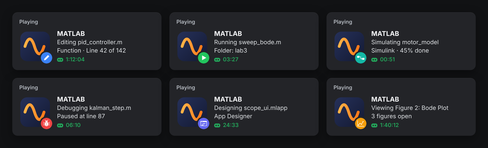

<div align="center">


# Discord Rich Presence for MATLAB

Discord shows when you're gaming or listening to Spotify.<br>
Six hours deep in MATLAB? Nothing. **drpc** fixes that.

**[Website and docs](https://akeanti.xyz/matlab-discord-rpc/)** · [Getting started](https://akeanti.xyz/matlab-discord-rpc/getting-started) · [Configuration](https://akeanti.xyz/matlab-discord-rpc/configuration) · [Troubleshooting](https://akeanti.xyz/matlab-discord-rpc/troubleshooting)

[](https://github.com/akeanti/matlab-discord-rpc/actions/workflows/ci.yml)
[](#install)
[](#install)
[](#why-drpc)
[](LICENSE)



</div>

## Install

Paste this into the MATLAB Command Window:

```matlab
unzip("https://github.com/akeanti/matlab-discord-rpc/archive/refs/heads/main.zip", tempdir); run(fullfile(tempdir, "matlab-discord-rpc-main", "install.m"))
```

Your status shows up on Discord a few seconds later, and from now on it starts with MATLAB by itself.

You need Windows 10 or 11, the Discord desktop app, and MATLAB R2021a or newer. That's the whole list.

<details>
<summary>Rather install by hand?</summary>

1. Download the [latest release](https://github.com/akeanti/matlab-discord-rpc/releases/latest) and unzip it.
2. In MATLAB, `cd` into that folder and run `install`.

Or copy the `DiscordRPC` folder into your MATLAB user folder (`userpath`), then run `drpc setup` and `drpc start`.
</details>

## What it shows

| When you're... | Discord shows |
|---|---|
| typing in the Editor | **Editing pid_controller.m** · Function · Line 42 of 142 · unsaved |
| running code | **Running sweep_bode.m**, timed from when the run started |
| stopped at a breakpoint | **Debugging kalman_step.m** · Paused at line 87 |
| running a Simulink model | **Simulating motor_model** · Simulink · 45% done |
| in a Simulink window | **Building motor_model** · Simulink · 48 blocks |
| in App Designer | **Designing scope_ui.mlapp** |
| looking at a figure | **Viewing Figure 2: Bode Plot** · 3 figures open |
| in the Command Window | **In the Command Window** · Folder: lab3 · 14 variables |
| gone for 10 minutes | **Away from keyboard** · Last on pid_controller.m |

Hover the small icon to see the folder and how many files are open. Close MATLAB and the status goes away.

## Why drpc

There's no Python or Node helper running in the background. drpc runs inside MATLAB and nothing else.

It also knows when your code is running, even when MATLAB is stuck in a long loop and can't run anything else. A watchdog on a background thread notices that MATLAB went quiet and switches you to "Running" with the right start time.

MATLAB never waits on Discord. All Discord traffic happens on that background thread, so if Discord is closed, restarting or slow, MATLAB doesn't notice. When Discord comes back, drpc reconnects.

There's nothing to trust blindly. The small C# bridge that talks to Discord is compiled on your PC from [`DrpcBridge.cs`](DiscordRPC/DrpcBridge.cs), using the compiler that already comes with Windows. The repo ships no DLLs or EXEs.

## Commands

```text
drpc              status, with clickable actions
drpc pause        hide your status for this session
drpc resume       show it again
drpc names off    say "Editing a function" instead of the file name
drpc config       open the settings
drpc preview      the exact payload plus diagnostics
drpc update       install the newest release from GitHub
drpc uninstall    stop it and take it out of startup.m
drpc docs         open the website
```

What `drpc` prints:

```text
>> drpc

  Discord Rich Presence for MATLAB  v1.1.0

  Discord       Connected as you
  Showing       Editing pid_controller.m
                Function · Line 42 of 142
  Settings      config.json  (names on, idle after 10 min)

  pause   hide names   preview   restart   stop   docs
```

## Settings

`drpc config` opens `config.json`. Changes apply as soon as you save, and a typo keeps your previous settings instead of resetting them.

```json
{
  "show_names": true,
  "hidden_folders": ["Internship"],
  "idle_minutes": 10,
  "member_list": "name",
  "buttons": [{ "label": "GitHub", "url": "https://github.com/you" }]
}
```

Every option is in [Configuration](https://akeanti.xyz/matlab-discord-rpc/configuration), and the ways to keep things private are in [Privacy](https://akeanti.xyz/matlab-discord-rpc/privacy). Want your profile to say "Playing Simulink", or use your own icons? See [using your own Discord app](https://akeanti.xyz/matlab-discord-rpc/own-discord-app).

## How it works

```text
MATLAB timer, every 2 s  ->  drpc.m  ->  C# bridge thread  ->  \\.\pipe\discord-ipc-0  ->  Discord
```

Every two seconds `drpc.m` reads the Editor, the window in front, Simulink and the debugger, builds the activity, and hands it to the bridge. The bridge sends an update only when something changed, at most once every 5 seconds, which is what Discord allows. The full story, including the watchdog, is in [How it works](https://akeanti.xyz/matlab-discord-rpc/how-it-works).

## FAQ

**macOS or Linux?**
Not yet. On those systems Discord listens on a Unix socket instead of a named pipe, and the bridge is .NET Framework. Supporting them is doable, and PRs are welcome.

**Does it send my code anywhere?**
No. It only talks to the Discord app on your own PC, and the only text it sends is what you see on your profile. See [SECURITY.md](SECURITY.md).

**Can I keep a project private?**
Add the folder name to `hidden_folders`, or run `drpc names off`. To hide everything for a while, run `drpc pause`.

**Will it start in my parfor workers or batch jobs?**
No. drpc only starts itself when there's a MATLAB desktop, so `-batch` jobs, parallel workers and MATLAB Engine sessions are left alone.

**MATLAB Online?**
No. Rich Presence needs the Discord app on the same machine as MATLAB.

**Which releases does it work on?**
It's tested on R2024a, and anything from R2021a up should work. On R2025a and newer, telling the Editor apart from the Command Window relies on the old desktop, so that one detail may be off. [Let me know](https://github.com/akeanti/matlab-discord-rpc/issues) how it goes.

Something not showing up? Check the [troubleshooting guide](https://akeanti.xyz/matlab-discord-rpc/troubleshooting). More answers are in the [FAQ](https://akeanti.xyz/matlab-discord-rpc/faq).

## Contributing

Ideas and PRs are welcome, especially for parts of MATLAB that drpc doesn't show yet. [CONTRIBUTING.md](CONTRIBUTING.md) covers the layout and how to run the tests.

If drpc made your profile a bit more interesting, a star helps other MATLAB people find it.

## License

[MIT](LICENSE). The status icons in [`assets/icons`](assets/icons) are free to use in your own projects.

<sub>Not affiliated with MathWorks or Discord. MATLAB and Simulink are registered trademarks of The MathWorks, Inc.</sub>
