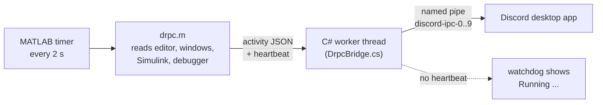

# How it works

drpc has two parts: `drpc.m`, which knows about MATLAB, and `DrpcBridge.cs`, which knows about Discord.



## Every 2 seconds

A MATLAB `timer` calls `drpc.m`, which takes a quick snapshot:

| What | From |
|---|---|
| Active file, line, line count, unsaved, open tabs | `matlab.desktop.editor` |
| Script, function, class or live script | first code line of the file |
| Command Window or Editor has the keyboard | the Java desktop's focus owner |
| Simulink, App Designer or a figure in front | foreground window title (`user32`) |
| Simulation running, % done, block count | `get_param` / `find_system`, only if Simulink is already loaded |
| Stopped at a breakpoint, and where | `feature('IsDebugMode')`, `dbstack` |
| Away from keyboard | `GetLastInputInfo` |
| MATLAB busy | process CPU time |

It turns that into a Discord activity (JSON) and hands it to the bridge together with a second, ready-made "Running ..." activity for the watchdog. The tick is wrapped so it never throws, because an error inside a `TimerFcn` would stop the timer for good.

## The bridge

MATLAB timers run on MATLAB's main thread. Talking to Discord there would mean MATLAB waits whenever Discord is slow, restarting, or not running at all. So the pipe lives on a .NET background thread instead:

- connects to `\\.\pipe\discord-ipc-0` to `-9`, does the handshake, answers pings
- sends an update only when something changed, at most one every 5 s (Discord allows 5 per 20 s), and the newest change always wins
- reads Discord's replies, so a rejected payload shows up in `drpc` instead of failing silently
- reconnects every 10 s if Discord closes or restarts
- forgets the previous run on `drpc restart`, so an old "Running" never flashes up
- clears your status on `drpc stop`, `drpc pause` and when MATLAB exits

`DrpcBridge.cs` is plain C# 5, compiled the first time you start drpc with the `csc.exe` that is part of .NET Framework 4 on every Windows 10 and 11 install. The DLL goes to `DiscordRPC/bin/` and is named after a hash of the source, so editing the source builds a fresh one. The repo contains no binaries; what runs is what you can read.

## The watchdog

When your code is busy in a loop, MATLAB does not run timer callbacks, so `drpc.m` cannot say "I'm running code". The bridge notices the missing heartbeat instead:

- no heartbeat for 4 s and MATLAB is using CPU, or
- no heartbeat for 15 s at all (waiting on a `parfor` pool, a serial port, a web request)

Then it shows the "Running ..." activity that `drpc.m` prepared in advance, with the timer set to the moment MATLAB went quiet. When the heartbeat comes back, the normal activity returns.

Code that does let timers run (loops with `drawnow`, `pause`, live plots) is caught on the MATLAB side instead: MATLAB's CPU above `busy_cpu_percent` for two ticks in a row.

## Files

```
DiscordRPC/
  drpc.m            everything on the MATLAB side
  DrpcBridge.cs     the Discord side
  config.json       your settings, created on first run
  bin/              the compiled bridge, created on first run
```

`drpc setup` adds a marked block to `startup.m` in your MATLAB user folder; `drpc uninstall` removes exactly that block.

`startup.m` runs in every MATLAB session, including ones nobody is looking at. `drpc autostart` skips `-batch` jobs and parallel pool workers right away, then waits a few seconds and checks for a desktop (`usejava('desktop')`, or `desktop('-inuse')` for the new desktop). No desktop, no Discord status.

## Settings

`config.json` is read again whenever its timestamp or size changes, so a save shows up on the next tick. If the new file isn't valid JSON, the previous settings stay in effect. A typo can't turn hidden names back on.
